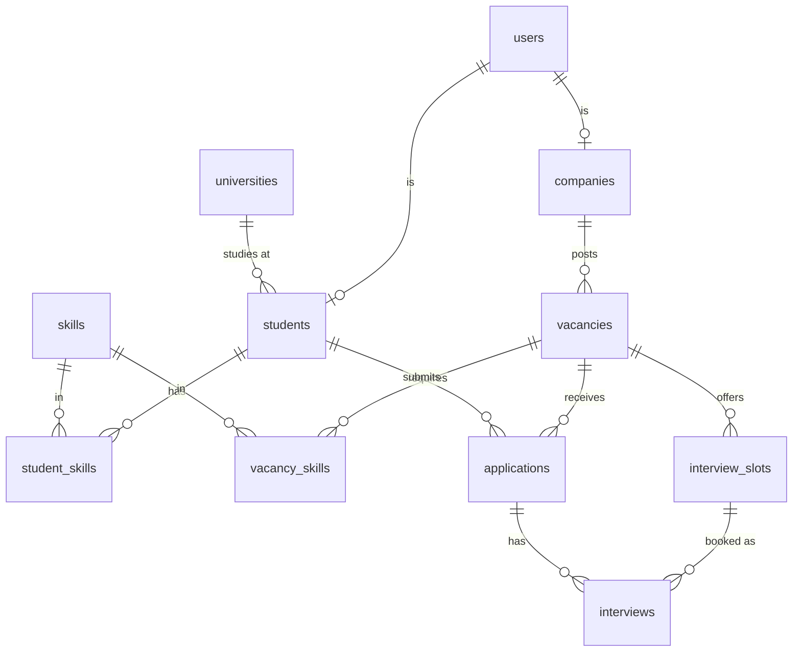

# Shogird — спецификация продукта

> **Shogird** (узб. «ученик, подмастерье», от традиции *ustoz–shogird*) — платформа стажировок, которая соединяет студентов вузов Узбекистана с IT-компаниями.
> Слоган: RU «Первый шаг в IT» · UZ «IT sohasiga ilk qadam» · EN «Your first step into IT»

| | |
|---|---|
| Версия | 0.1 · 2026-11-02 |
| Формат | Хакатон-проект по гайду курса *Big Data · Build Your Own Database + Website in 3 Weeks* (`docs/BigData_3Week_Project_Guide.pdf`) |
| Объём | **Расширенный MVP**: всё, что требует гайд, плюс вход для студентов и компаний (bcrypt) и кабинет компании с откликами |
| Язык интерфейса | Переключатель **RU / UZ / EN** |

Этот файл описывает, **что** строим. Документ `CLAUDE.md` описывает, **как** работаем с кодом. Если код и SPEC расходятся, верным считается SPEC, а расхождение нужно обсудить и затем исправить одно из двух.

---

## 1. Проблема и решение

**Проблема.**
- Студенты не знают, где искать стажировку и каких навыков им не хватает. Отклики в Telegram-каналах и на общих job-сайтах остаются без ответа и без статуса.
- Компании тратят время на неподходящих кандидатов, а собеседования согласуют вручную в переписке.
- Вузы не видят, каких навыков рынок ждёт от выпускников.

**Решение.** В Shogird есть:
1. Каталог стажировок с поиском и фильтрами (направление, город, формат, оплачиваемость, навык, «резидент IT Park»).
2. Профиль навыков студента и **% совпадения** с каждой вакансией.
3. Прозрачная воронка заявки: *подана → в шорт-листе → собеседование → оффер → принят*.
4. Запись на собеседование **по слотам**: компания публикует время, студент выбирает, двойная бронь невозможна.
5. Аналитика **«разрыв навыков»**: что ищут студенты, что требуют вакансии и что реально умеют студенты.

**Монетизация (для презентации):** платное продвижение вакансий; подписка для компаний (больше активных вакансий, расширенная аналитика по кандидатам); платные отчёты для вузов о востребованности навыков.

**Конкуренты:** hh.uz (общий рынок, не заточен под стажёров и студентов), Telegram-каналы с вакансиями (нет статусов, фильтров и аналитики).

---

## 2. Роли

| Роль | Что может |
|---|---|
| **Гость** | Смотреть каталог и карточки вакансий, профили компаний, страницу аналитики |
| **Студент** | Профиль, навыки с уровнем, резюме (портфолио), отклик на вакансию, отслеживание статусов, запись на собеседование, принять или отклонить оффер, отозвать заявку, оставить отзыв о стажировке |
| **Компания** | Профиль компании, создание, редактирование и закрытие вакансий с навыками, управление слотами собеседований, просмотр кандидатов с % совпадения, смена статусов заявок |
| **Админ** | *Вне объёма MVP* (см. §15). Роль есть в схеме `users.role`, но интерфейса нет |

---

## 3. Архитектура

```
Browser (HTML + CSS + vanilla JS, i18n RU/UZ/EN)
        │ fetch('/api/...')  JSON
        ▼
Node.js 20+ / Express 4  (server/src)
   ├── pg  ─────────────▶ PostgreSQL : пользователи, профили, вакансии, заявки, слоты, собеседования
   └── mongodb driver ──▶ MongoDB    : события (clickstream), поисковые запросы, резюме, отзывы о стажировках
```

**Почему две базы (polyglot persistence):**

| Данные | Где | Почему |
|---|---|---|
| Пользователи, заявки, слоты, места на стажировке | PostgreSQL | Нужны транзакции и жёсткие правила: слот нельзя забронировать дважды, мест не может стать меньше нуля, один студент подаёт одну заявку на вакансию |
| Клики, просмотры, поисковые запросы | MongoDB | Большой объём, быстрый поток, аналитика через aggregation pipeline |
| Резюме и портфолио | MongoDB | Структура у всех разная: у одного 5 проектов и сертификаты, у другого только «о себе» |
| Отзывы о стажировках | MongoDB | Гибкие поля (теги, плюсы и минусы), читаются вместе с карточкой компании |

**Стек (только бесплатное):** PostgreSQL 16/17 + pgAdmin, MongoDB Community + Compass, Node.js 20/22 LTS, Express 4, `pg`, `mongodb`, `dotenv`, `bcryptjs`, `jsonwebtoken`, `cookie-parser`. Фронтенд на чистом HTML/CSS/JS без сборки. Деплой: Supabase (PostgreSQL), MongoDB Atlas M0, Render (web service).

---

## 4. Структура репозитория

```
shogird/
├─ SPEC.md                 ← этот файл
├─ CLAUDE.md               ← правила работы с кодом
├─ README.md               ← как запустить, демо-аккаунты
├─ docs/
│  ├─ BigData_3Week_Project_Guide.pdf
│  ├─ er_diagram.png       ← ER-диаграмма (pgAdmin ERD Tool или draw.io)
│  └─ report/              ← скриншоты и материалы для отчёта
├─ sql/
│  ├─ 01_schema.sql        ← DROP + CREATE, безопасно перезапускать
│  ├─ 02_seed.sql          ← реалистичные данные + демо-сценарии
│  ├─ 03_queries.sql       ← 20 запросов с комментариями «какой бизнес-вопрос»
│  └─ 04_big_data.sql      ← 500 000 строк, EXPLAIN ANALYZE до/после индекса
├─ mongo/
│  ├─ 01_setup.mongodb.js  ← playground/mongosh: коллекции, генерация, индексы
│  └─ 02_queries.mongodb.js← 12 запросов (5 CRUD, 5 агрегаций, 2 index/explain)
└─ server/
   ├─ package.json  .env.example  .gitignore
   ├─ scripts/             ← db-create, run-sql, seed-mongo, smoke, i18n-check
   ├─ src/
   │  ├─ server.js         ← app, статика, подключение роутов, обработчик ошибок
   │  ├─ db.js             ← pg Pool + MongoClient
   │  ├─ middleware/auth.js
   │  ├─ lib/              ← validate.js, errors.js, events.js (логирование в Mongo)
   │  └─ routes/           ← auth.js, catalog.js, student.js, company.js, stats.js
   └─ public/
      ├─ index.html  vacancy.html  company.html  auth.html
      ├─ student.html  company-panel.html  dashboard.html
      ├─ app.js            ← общие хелперы (api, esc, формат денег, шапка)
      ├─ i18n.js           ← словари ru/uz/en + t()
      ├─ pages/*.js        ← логика каждой страницы
      └─ style.css
```

---

## 5. PostgreSQL: схема

### 5.1 ER-диаграмма



Связей M:N две: `students ↔ skills` через `student_skills` и `vacancies ↔ skills` через `vacancy_skills`. Связь `students ↔ vacancies` тоже M:N, она реализована через `applications`.

### 5.2 Справочные значения (используются в CHECK и i18n)

- **direction / skill category:** `frontend`, `backend`, `mobile`, `data`, `design`, `qa`, `devops`, `pm`
- **work_format:** `office`, `remote`, `hybrid`
- **cities:** `Tashkent`, `Samarkand`, `Bukhara`, `Namangan`, `Andijan`, `Fergana`, `Nukus`, `Karshi`, `Urgench`
- **application.status:** `submitted`, `shortlisted`, `interview`, `offer`, `accepted`, `declined`, `rejected`, `withdrawn`
- **vacancy.status:** `draft`, `open`, `closed`
- **interview.status:** `scheduled`, `done`, `no_show`, `cancelled`

### 5.3 Таблицы

**users** (учётные записи)
| Колонка | Тип | Ограничения |
|---|---|---|
| user_id | SERIAL | PK |
| email | VARCHAR(120) | NOT NULL UNIQUE, `CHECK (email = lower(email))` |
| password_hash | VARCHAR(100) | NOT NULL (bcrypt) |
| role | VARCHAR(10) | NOT NULL, CHECK IN (`student`,`company`,`admin`) |
| created_at | TIMESTAMPTZ | NOT NULL DEFAULT now() |

**universities**
| Колонка | Тип | Ограничения |
|---|---|---|
| university_id | SERIAL | PK |
| name | VARCHAR(150) | NOT NULL UNIQUE |
| short_name | VARCHAR(20) | |
| city | VARCHAR(50) | NOT NULL |

**students** (профиль студента, 1:1 с users)
| Колонка | Тип | Ограничения |
|---|---|---|
| student_id | SERIAL | PK |
| user_id | INT | NOT NULL UNIQUE → users ON DELETE CASCADE |
| full_name | VARCHAR(100) | NOT NULL |
| university_id | INT | → universities (NULL допустим) |
| course | SMALLINT | CHECK (course BETWEEN 1 AND 6) |
| city | VARCHAR(50) | NOT NULL DEFAULT 'Tashkent' |
| phone | VARCHAR(20) | формат `+998…` |
| bio | TEXT | |
| github_url | TEXT | |
| created_at | TIMESTAMPTZ | NOT NULL DEFAULT now() |

**companies** (профиль компании, 1:1 с users)
| Колонка | Тип | Ограничения |
|---|---|---|
| company_id | SERIAL | PK |
| user_id | INT | NOT NULL UNIQUE → users ON DELETE CASCADE |
| name | VARCHAR(120) | NOT NULL UNIQUE |
| city | VARCHAR(50) | NOT NULL |
| website | TEXT | |
| description | TEXT | |
| employees_range | VARCHAR(10) | CHECK IN (`1-10`,`11-50`,`51-200`,`200+`) |
| is_itpark_resident | BOOLEAN | NOT NULL DEFAULT false |
| logo_url | TEXT | можно `/placeholder.svg?text=...` как в гайде |
| created_at | TIMESTAMPTZ | NOT NULL DEFAULT now() |

**skills**
| Колонка | Тип | Ограничения |
|---|---|---|
| skill_id | SERIAL | PK |
| name | VARCHAR(50) | NOT NULL UNIQUE (`JavaScript`, `React`, `SQL`, `Docker`, `Figma`…) |
| category | VARCHAR(20) | NOT NULL, CHECK IN directions |

**student_skills** (M:N)
| Колонка | Тип | Ограничения |
|---|---|---|
| student_id | INT | → students ON DELETE CASCADE |
| skill_id | INT | → skills |
| level | SMALLINT | NOT NULL CHECK (level BETWEEN 1 AND 5) |
| | | PK (student_id, skill_id) |

**vacancies** (стажировки)
| Колонка | Тип | Ограничения |
|---|---|---|
| vacancy_id | SERIAL | PK |
| company_id | INT | NOT NULL → companies |
| title | VARCHAR(150) | NOT NULL |
| description | TEXT | NOT NULL |
| direction | VARCHAR(20) | NOT NULL, CHECK IN directions |
| work_format | VARCHAR(10) | NOT NULL, CHECK IN work formats |
| city | VARCHAR(50) | NOT NULL |
| is_paid | BOOLEAN | NOT NULL DEFAULT false |
| stipend | NUMERIC(12,2) | NULL или ≥ 0, сумма в сумах в месяц; `CHECK (is_paid OR stipend IS NULL)` |
| duration_months | SMALLINT | NOT NULL CHECK (1..12) |
| seats | SMALLINT | NOT NULL CHECK (seats > 0) |
| seats_left | SMALLINT | NOT NULL, `CHECK (seats_left BETWEEN 0 AND seats)` |
| status | VARCHAR(10) | NOT NULL DEFAULT 'open', CHECK IN vacancy statuses |
| deadline | DATE | NULL = без дедлайна |
| created_at, updated_at | TIMESTAMPTZ | NOT NULL DEFAULT now() |

**vacancy_skills** (M:N)
| Колонка | Тип | Ограничения |
|---|---|---|
| vacancy_id | INT | → vacancies ON DELETE CASCADE |
| skill_id | INT | → skills |
| is_required | BOOLEAN | NOT NULL DEFAULT true (false = «будет плюсом») |
| | | PK (vacancy_id, skill_id) |

**applications** (заявки)
| Колонка | Тип | Ограничения |
|---|---|---|
| application_id | SERIAL | PK |
| vacancy_id | INT | NOT NULL → vacancies |
| student_id | INT | NOT NULL → students |
| status | VARCHAR(12) | NOT NULL DEFAULT 'submitted', CHECK IN application statuses |
| cover_letter | TEXT | |
| company_note | TEXT | видна только компании |
| created_at, updated_at | TIMESTAMPTZ | NOT NULL DEFAULT now() |
| | | **UNIQUE (vacancy_id, student_id)**, т.е. одна заявка на вакансию |

**interview_slots** (время собеседований)
| Колонка | Тип | Ограничения |
|---|---|---|
| slot_id | SERIAL | PK |
| vacancy_id | INT | NOT NULL → vacancies ON DELETE CASCADE |
| starts_at | TIMESTAMPTZ | NOT NULL |
| duration_min | SMALLINT | NOT NULL DEFAULT 30 CHECK (10..180) |
| place | TEXT | адрес офиса или ссылка на звонок |
| is_booked | BOOLEAN | NOT NULL DEFAULT false |
| | | UNIQUE (vacancy_id, starts_at) |

**interviews** (бронь слота конкретной заявкой)
| Колонка | Тип | Ограничения |
|---|---|---|
| interview_id | SERIAL | PK |
| slot_id | INT | NOT NULL → interview_slots |
| application_id | INT | NOT NULL → applications ON DELETE CASCADE |
| status | VARCHAR(10) | NOT NULL DEFAULT 'scheduled', CHECK IN interview statuses |
| score | SMALLINT | NULL или CHECK (1..5) |
| feedback | TEXT | |
| created_at | TIMESTAMPTZ | NOT NULL DEFAULT now() |
| | | **Частичные уникальные индексы:** `UNIQUE (slot_id) WHERE status <> 'cancelled'` и `UNIQUE (application_id) WHERE status <> 'cancelled'` |

> Частичный уникальный индекс работает как вторая линия защиты от двойной брони. Отменённое собеседование освобождает слот, и тот же слот можно забронировать заново. Это удобный вопрос для защиты.

### 5.4 Индексы

На все FK и частые фильтры: `students(university_id)`, `vacancies(company_id)`, `vacancies(status, direction)`, `vacancies(city)`, `vacancy_skills(skill_id)`, `student_skills(skill_id)`, `applications(student_id)`, `applications(vacancy_id, status)`, `interview_slots(vacancy_id, starts_at)`.

### 5.5 Представления

- `v_vacancy_catalog`: вакансия + название компании + `is_itpark_resident` + число заявок. Используется в каталоге.
- `mv_direction_monthly` (materialized, в `04_big_data.sql`): помесячная сводка архива заявок по направлениям.

---

## 6. Бизнес-правила и транзакции

### 6.1 Жизненный цикл заявки

```
submitted ──(компания)──▶ shortlisted ──(студент бронирует слот, T2)──▶ interview ──(компания)──▶ offer ──(студент, T3)──▶ accepted
    │                          │                                         │                         │
    └──(компания)──▶ rejected ◀┴─────────────────────────────────────────┘                         └──(студент)──▶ declined
Любой активный статус (submitted, shortlisted, interview, offer) ──(студент)──▶ withdrawn
```

- Терминальные статусы: `accepted`, `declined`, `rejected`, `withdrawn`.
- Недопустимый переход → **409 `INVALID_STATUS`**. Таблицу допустимых переходов держать в одном месте кода (`lib/statuses.js`).
- Когда компания переводит заявку из `interview` в `offer` или `rejected`, собеседование получает `status = 'done'` (можно передать `score` и `feedback`).

### 6.2 Отклик на вакансию

- Только роль `student`. Вакансия должна быть `open` (иначе **409 `VACANCY_CLOSED`**), а `deadline` не прошёл (иначе **409 `DEADLINE_PASSED`**).
- Повторная заявка ловится по UNIQUE (vacancy_id, student_id) → **409 `ALREADY_APPLIED`**.

### 6.3 Транзакции (BEGIN / COMMIT / ROLLBACK на одном `client`)

**T1. Регистрация.** `INSERT users` → `INSERT students` или `INSERT companies` → COMMIT. Дубликат email → ROLLBACK, **409 `EMAIL_TAKEN`**.

**T2. Бронь слота собеседования** (главная транзакция для демо):
1. `SELECT … FROM applications WHERE application_id = $1 FOR UPDATE`. Заявка должна принадлежать текущему студенту и иметь статус `shortlisted`, иначе 404 / 409 `INVALID_STATUS`.
2. Атомарная проверка и бронь одним запросом:
   `UPDATE interview_slots SET is_booked = true WHERE slot_id = $1 AND vacancy_id = $2 AND is_booked = false AND starts_at > now() RETURNING *`
   Если затронуто 0 строк → ROLLBACK, **409 `SLOT_TAKEN`**.
3. `INSERT INTO interviews (slot_id, application_id)`.
4. `UPDATE applications SET status = 'interview', updated_at = now()`.
5. COMMIT. **После** COMMIT, без ожидания, пишется событие `slot_booked` в Mongo.

**T3. Принять оффер** (вторая транзакция, демо «последнее место»):
1. `SELECT … FROM applications … FOR UPDATE`, статус должен быть `offer`.
2. `UPDATE vacancies SET seats_left = seats_left - 1, status = CASE WHEN seats_left = 1 THEN 'closed' ELSE status END WHERE vacancy_id = $1 AND seats_left > 0 RETURNING seats_left`. Если 0 строк → ROLLBACK, **409 `NO_SEATS`**.
3. Заявка → `accepted`.
4. Остальные **активные** заявки этого студента → `withdrawn`. Правило: принять можно только один оффер.
5. Их будущие собеседования → `cancelled`, соответствующие слоты → `is_booked = false`.
6. COMMIT, затем событие `offer_accepted` в Mongo.

**T4. Сохранение вакансии с навыками** (создание и редактирование): `INSERT/UPDATE vacancies` + `DELETE/INSERT vacancy_skills` в одной транзакции.

**T5. Замена набора навыков студента:** `DELETE student_skills` + `INSERT` в одной транзакции.

### 6.4 Процент совпадения (match score)

Обязательный навык весит 1, навык «будет плюсом» весит 0,5. Наличие навыка у студента считается при `level ≥ 1`.

```sql
-- % совпадения студента $1 со всеми открытыми вакансиями
SELECT v.vacancy_id,
       ROUND(100.0 * SUM(CASE WHEN ss.skill_id IS NOT NULL
                              THEN CASE WHEN vs.is_required THEN 1 ELSE 0.5 END ELSE 0 END)
                   / SUM(CASE WHEN vs.is_required THEN 1 ELSE 0.5 END))::int AS match_pct
FROM vacancies v
JOIN vacancy_skills vs ON vs.vacancy_id = v.vacancy_id
LEFT JOIN student_skills ss ON ss.skill_id = vs.skill_id AND ss.student_id = $1
WHERE v.status = 'open'
GROUP BY v.vacancy_id;
```

У вакансии без навыков `match_pct = null`, в интерфейсе бейдж просто не показывается.

### 6.5 Отзыв о стажировке

Оставить отзыв о компании можно только студенту, у которого есть заявка в статусе `accepted` на вакансию этой компании. Это проверяется в PostgreSQL, а сам отзыв пишется в MongoDB: правило проходит через обе базы. Один отзыв на пару (компания, студент) → иначе **409 `REVIEW_EXISTS`**. Нет права → **403 `REVIEW_NOT_ALLOWED`**.

---

## 7. MongoDB

База: `shogird`. ID в документах (`studentId`, `vacancyId`, `companyId`) совпадают с ID в PostgreSQL из сида.

| Коллекция | Назначение | Объём в сиде | Форма документа |
|---|---|---|---|
| `events` | clickstream для воронки и активности | **60 000** за последние 90 дней | `{ type, userId, role, vacancyId, companyId, direction, city, device, ts }` |
| `search_logs` | что ищут студенты → спрос на навыки | **30 000** | `{ q, filters: { direction, city, format, paid, skills: [..] }, results, userId, lang, ts }` |
| `resumes` | гибкое портфолио студента | по одному на студента (~40) | `{ studentId, about, languages: [{ code, level }], projects: [{ title, url, stack: [..] }], certificates: [{ name, year }], updatedAt }` |
| `internship_reviews` | отзывы о стажировках | ~40 | `{ companyId, studentId, rating 1–5, pros, cons, tags: [..], wouldRecommend, createdAt }` |

- **events.type:** `vacancy_view` (~70%), `company_view` (~5%), `apply` (~15%), `slot_booked` (~7%), `offer_accepted` (~3%). Распределение даёт правдоподобную воронку.
- **Индексы:** `events { type: 1, ts: -1 }`, `events { vacancyId: 1 }`, `search_logs { ts: -1 }`, `search_logs { "filters.skills": 1 }`, `resumes { studentId: 1 }` (unique), `internship_reviews { companyId: 1, createdAt: -1 }`, `internship_reviews { companyId: 1, studentId: 1 }` (unique).
- **Генерация должна рассказывать историю для дашборда:** студенты чаще всего ищут Python, React и UI/UX, а вакансии чаще всего требуют SQL, Git, Docker и тестирование, которых у студентов мало. Тогда «разрыв навыков» на демо выглядит осмысленно.
- Сырые события пишутся сервером **без ожидания** (`.catch(console.error)`) и **только после COMMIT** денежной или бронирующей части, как в гайде.

---

## 8. Big Data эксперимент (PostgreSQL, `04_big_data.sql`)

- Таблица `applications_archive`: `id BIGSERIAL, direction, city, university_id, status (accepted|rejected|no_response), response_hours INT, applied_at TIMESTAMPTZ`, **500 000 строк** через `generate_series` за последние 2 года. Нужна сезонность: пик заявок в мае–июле (летние стажировки).
- Эксперимент: `EXPLAIN ANALYZE` запроса «backend-заявки в Ташкенте за последние 30 дней» **до** и **после** `CREATE INDEX idx_archive_dir_city_date ON applications_archive (direction, city, applied_at)`. Оба времени выполнения записать в отчёт.
- Аналитика: помесячный тренд (видна сезонность), `mv_direction_monthly` + `REFRESH`, топ-3 вуза по числу принятых в каждом направлении (`ROW_NUMBER() OVER (PARTITION BY …)`), среднее время ответа компаний по городам.

---

## 9. API

Все ответы в JSON. Ошибки приходят в виде `{ "error": "<текст на английском>", "code": "<КОД>" }`. Фронтенд переводит ошибку по `code` (см. §10.3).
Приоритет: **P0** нужно для MVP и демо, **P1** делается, если остаётся время.

### 9.1 Публичные
| # | Метод и путь | Приоритет | БД | Назначение |
|---|---|---|---|---|
| 1 | `GET /api/health` | P0 | PG + Mongo | `{ ok, postgresTime, mongoEvents }` |
| 2 | `GET /api/meta` | P0 | PG | Навыки, вузы, города, направления для фильтров и форм |
| 3 | `GET /api/vacancies?q&direction&city&format&paid&skill&resident&page` | P0 | PG (+ лог в Mongo) | Каталог: поиск, фильтры, пагинация по 12. Каждый поиск пишется в `search_logs` |
| 4 | `GET /api/vacancies/:id` | P0 | PG + Mongo | Вакансия, компания, навыки; просмотры за 30 дней и рейтинг компании из Mongo; для студента ещё `match_pct` и статус его заявки. Пишет событие `vacancy_view` |
| 5 | `GET /api/companies/:id` | P1 | PG + Mongo | Профиль, открытые вакансии, отзывы и средний рейтинг |

### 9.2 Аутентификация
| # | Метод и путь | Приоритет | Назначение |
|---|---|---|---|
| 6 | `POST /api/auth/register` | P0 | T1. Body: `{ role, email, password, fullName \| companyName, … }` → ставит cookie |
| 7 | `POST /api/auth/login` | P0 | bcrypt compare → cookie. Неверные данные → 401 `INVALID_CREDENTIALS` (один и тот же текст для «нет email» и «неверный пароль») |
| 8 | `POST /api/auth/logout` | P0 | Очищает cookie |
| 9 | `GET /api/auth/me` | P0 | `{ userId, role, profileId, name }` или 401 |

### 9.3 Студент (`role = student`)
| # | Метод и путь | Приоритет | БД | Назначение |
|---|---|---|---|---|
| 10 | `GET /api/me/profile`, `PUT /api/me/profile` | P0 | PG | Профиль |
| 11 | `PUT /api/me/skills` | P0 | PG | T5. Body: `[{ skillId, level }]` |
| 12 | `GET /api/me/resume`, `PUT /api/me/resume` | P1 | Mongo | Резюме (upsert по `studentId`) |
| 13 | `GET /api/me/recommendations` | P0 | PG | Топ-10 открытых вакансий по `match_pct` |
| 14 | `POST /api/vacancies/:id/apply` | P0 | PG (+ событие) | Отклик. 201 или 409 (`ALREADY_APPLIED`, `VACANCY_CLOSED`, `DEADLINE_PASSED`) |
| 15 | `GET /api/me/applications` | P0 | PG | Мои заявки с вакансией, компанией и временем собеседования |
| 16 | `GET /api/applications/:id/slots` | P0 | PG | Свободные будущие слоты (только при статусе `shortlisted`) |
| 17 | `POST /api/applications/:id/book` | P0 | PG (+ событие) | **T2**. Body `{ slotId }`. 409 `SLOT_TAKEN` |
| 18 | `POST /api/applications/:id/accept` | P0 | PG (+ событие) | **T3**. 409 `NO_SEATS` |
| 19 | `POST /api/applications/:id/decline`, `…/withdraw` | P1 | PG | Отказ от оффера или отзыв заявки |
| 20 | `POST /api/companies/:id/reviews` | P1 | PG check + Mongo | Отзыв о стажировке (§6.5) |

### 9.4 Компания (`role = company`)
Компания видит и меняет **только свои** вакансии, заявки и слоты. На чужой ID возвращается **404** (существование чужих данных не раскрывается).

| # | Метод и путь | Приоритет | БД | Назначение |
|---|---|---|---|---|
| 21 | `GET /api/company/vacancies` | P0 | PG | Свои вакансии + число заявок по статусам |
| 22 | `POST /api/company/vacancies` | P0 | PG | T4. Создать вакансию с навыками |
| 23 | `PUT /api/company/vacancies/:id` | P0 | PG | T4. Редактировать |
| 24 | `DELETE /api/company/vacancies/:id` | P1 | PG | Мягкое закрытие (`status = 'closed'`) |
| 25 | `GET /api/company/vacancies/:id/applications` | P0 | PG + Mongo | Кандидаты: профиль, навыки, `match_pct`, краткое резюме из Mongo. Сортировка по `match_pct` |
| 26 | `PATCH /api/company/applications/:id` | P0 | PG | Смена статуса (`shortlisted`, `rejected`, `offer`) + `company_note`, `score`, `feedback` |
| 27 | `GET /api/company/vacancies/:id/slots`, `POST …/slots` | P0 | PG | Список и создание слотов (только в будущем, иначе 400 `SLOT_IN_PAST`) |
| 28 | `DELETE /api/company/slots/:id` | P1 | PG | Удалить слот, только если он свободен, иначе 409 `SLOT_BOOKED` |

### 9.5 Аналитика (публичная)
| # | Метод и путь | Приоритет | БД | Что показывает |
|---|---|---|---|---|
| 29 | `GET /api/stats/overview` | P0 | PG + Mongo | KPI: открытые вакансии, студенты, компании, заявки, доля принятых; события за 7 дней |
| 30 | `GET /api/stats/skills-gap` | P0 | Mongo + PG | По каждому навыку: сколько раз искали (Mongo `$unwind` по `filters.skills`), сколько открытых вакансий требуют (PG), сколько студентов владеют (PG). Плюс «дефицит» = спрос вакансий минус предложение студентов. **Главный «вау» для жюри** |
| 31 | `GET /api/stats/funnel?direction=` | P0 | Mongo | Просмотры → отклики → собеседования → принятые |
| 32 | `GET /api/stats/cities` | P1 | PG | По городам: вакансии, заявки, средняя стипендия (GROUP BY + HAVING) |
| 33 | `GET /api/stats/activity` | P1 | Mongo | События по дням за 30 дней (`$dateToString`) |
| 34 | `GET /api/stats/top-companies` | P1 | PG + Mongo | Заявки (PG) + просмотры (Mongo) + рейтинг (Mongo) |

### 9.6 Коды ошибок
`VALIDATION` 400 · `SLOT_IN_PAST` 400 · `UNAUTHORIZED` 401 · `INVALID_CREDENTIALS` 401 · `FORBIDDEN` 403 · `REVIEW_NOT_ALLOWED` 403 · `NOT_FOUND` 404 · `EMAIL_TAKEN` 409 · `ALREADY_APPLIED` 409 · `VACANCY_CLOSED` 409 · `DEADLINE_PASSED` 409 · `INVALID_STATUS` 409 · `SLOT_TAKEN` 409 · `SLOT_BOOKED` 409 · `NO_SEATS` 409 · `REVIEW_EXISTS` 409 · `SERVER_ERROR` 500

### 9.7 Аутентификация: реализация
- `bcryptjs` с cost 10. Пароль не короче 8 символов. Email приводится к нижнему регистру.
- JWT подписывается `JWT_SECRET` из `.env`, payload `{ userId, role, profileId }`, срок 7 дней.
- Хранится в httpOnly cookie `shogird_token` с `sameSite: 'lax'` и `secure` в production. На Render нужен `app.set('trust proxy', 1)`.
- Middleware: `optionalAuth` (ставит `req.user`, если cookie валиден), `requireAuth`, `requireRole('student' | 'company')`.

---

## 10. Фронтенд

### 10.1 Страницы
| Файл | Приоритет | Содержимое |
|---|---|---|
| `index.html` | P0 | Шапка (логотип, «Вакансии», «Аналитика», «Войти» или «Кабинет», переключатель RU · UZ · EN), короткий hero со слоганом, строка поиска, фильтры (направление, город, формат, оплачиваемая, навык, «только резиденты IT Park»), сетка карточек (должность, компания, город и формат, стипендия или «без оплаты», до 3 навыков чипсами, бейдж «N% совпадение» для студента), пагинация |
| `vacancy.html?id=` | P0 | Описание, условия, места (`seats_left / seats`), навыки (обязательные и «будет плюсом»; у залогиненного студента подсвечены те, что у него есть), блок компании с рейтингом, кнопка «Откликнуться» с сопроводительным письмом или текущий статус заявки |
| `auth.html` | P0 | Вкладки «Вход» и «Регистрация»; при регистрации переключатель «Я студент / Я компания» и соответствующие поля |
| `student.html` | P0 | Вкладки: **Профиль и навыки** (мультивыбор навыков с уровнем 1–5) · **Резюме** (P1) · **Мои заявки** (бейджи статусов; при `shortlisted` кнопка «Выбрать время» с модалкой слотов; при `offer` кнопки «Принять» и «Отказаться»; при `accepted` кнопка «Оставить отзыв») · **Рекомендации** |
| `company-panel.html` | P0 | Вкладки: **Мои вакансии** (список + форма создания и редактирования с выбором навыков) · **Кандидаты** (по выбранной вакансии, сортировка по %, кнопки «В шорт-лист», «Отказ», «Оффер») · **Слоты** (создать, список, отметка «занят») |
| `dashboard.html` | P0 | KPI-плитки, «разрыв навыков» (топ-10 дефицитных навыков: три полосы на навык), воронка, города (P1), активность по дням (P1), топ компаний (P1). Графики на CSS-полосах, как в гайде, без JS-библиотек |
| `company.html?id=` | P1 | Публичный профиль компании, её вакансии и отзывы |

### 10.2 Общие правила UI
- Любой пользовательский текст вставляется только через `esc()`, как в гайде (защита от XSS).
- Деньги форматируются через `Intl.NumberFormat` по текущему языку + «сум» / «soʻm» / «UZS».
- Каждая форма показывает понятную ошибку по `code` и состояние загрузки. Пустые списки показывают дружелюбный текст.
- Mobile-first: верстка корректна при ширине 360 px, боковые отступы 16 px, без горизонтального скролла.
- В консоли браузера не должно быть красных ошибок.

### 10.3 i18n (RU / UZ / EN)
- `public/i18n.js` содержит объект `{ ru: {...}, uz: {...}, en: {...} }` с **одинаковым набором ключей**, функции `t(key, params)`, `applyI18n(root)` (обходит `[data-i18n]`, `[data-i18n-placeholder]`, `[data-i18n-title]`), `setLang(lang)` и `getLang()`.
- Язык хранится в `localStorage` под ключом `shogird.lang` (обращения обёрнуты в try/catch). Язык по умолчанию `ru`. При смене языка обновляется `<html lang>` и перерисовывается текущая страница без перезагрузки.
- Перечисления переводятся по ключам: `status.offer`, `direction.backend`, `format.remote`, `city.Tashkent`, ошибки `err.SLOT_TAKEN` и т.д.
- Узбекский пишется латиницей с корректным символом **ʻ** (U+02BB): *oʻ, gʻ, soʻm, Oʻzbekcha*.
- Контент из базы (названия вакансий, описания) не переводится, он одноязычный, как ввёл автор.
- Скрипт `npm run i18n:check` сверяет наборы ключей трёх словарей и падает, если ключи расходятся.

### 10.4 Визуальный стиль
Палитра вдохновлена изразцами Регистана:

| Токен | Цвет | Использование |
|---|---|---|
| `--lapis` | `#1F3C88` | основной цвет: шапка, кнопки |
| `--firuza` | `#0FA3A3` | акцент, успех, высокий % совпадения |
| `--zar` | `#E2A93B` | бейджи «резидент IT Park», выделение |
| `--anor` | `#C8453A` | ошибки, отказ |
| `--paper` | `#F7F5F0` | фон страницы |
| `--ink` | `#1B1F2A` | основной текст |
| `--muted` | `#6B7280` | вторичный текст |

Шрифт **Manrope** (Google Fonts) с системным фолбэком. Карточки со скруглением 12 px и мягкой тенью. Логотип текстовый: «Shogird» плюс простой геометрический знак (восьмиконечная звезда-гирих в SVG). Тёмная тема не нужна.

---

## 11. Сид-данные (`02_seed.sql`)

Данные реалистичные: узбекские имена, реальные вузы и города, суммы в сумах. **Компании вымышленные**, реальные бренды не используются (например, *Silk Code*, *Registan Labs*, *Chorsu Digital*, *Navoiy Soft*, *Bulut Tech*, *Amudaryo Data*, *Kapalak Mobile*, *Tashkent AI Lab*…).

| Таблица | Объём |
|---|---|
| universities | 10 (INHA, WIUT, TUIT, Turin Polytechnic, NUUz, Samarkand State University, New Uzbekistan University, Amity, Webster, Central Asian University) |
| skills | ~40 по всем категориям |
| companies (+ users) | 12, из них 7 резидентов IT Park |
| students (+ users) | 40 из разных вузов и городов |
| vacancies | 30: 26 `open`, 3 `closed`, 1 `draft`; стипендии 1 500 000–6 000 000 сум |
| vacancy_skills / student_skills | ~90 / ~150 |
| applications | ~60, покрывают все статусы |
| interview_slots / interviews | ~40 / ~15 |

**Демо-аккаунты** (один общий пароль `Shogird2026!`, его bcrypt-хэш вписан в сид; аккаунты перечислены в README):
- студент `aziza@example.uz`, студент `bekzod@example.uz`, компания `hr@registanlabs.example.uz`.

**Обязательные демо-сценарии в сиде:**
- **D1.** У Азизы есть заявка в статусе `shortlisted` на вакансию со свободными будущими слотами → на демо она бронирует слот (T2).
- **D2.** Вакансия *Junior Backend Intern* (Registan Labs) с `seats_left = 1`, у Азизы и Бекзода на неё статус `offer` → первый принимает оффер, второй получает **409 `NO_SEATS`**, данные не меняются (ROLLBACK).
- **D3.** На одну из вакансий есть уже занятый слот → попытка его забронировать (через Thunder Client) даёт **409 `SLOT_TAKEN`**.
- **D4.** У Registan Labs есть кандидаты в статусах `submitted` и `interview` → на демо компания двигает их по воронке.

Даты в сиде задаются относительно `now()` (например, `now() + interval '2 days'`), чтобы слоты не «протухали». Генерация в скриптах детерминированная: фиксированный seed PRNG, например mulberry32.

---

## 12. Учебные артефакты по гайду

**`03_queries.sql`, 20 запросов**, над каждым комментарий с бизнес-вопросом:
- 4 CRUD (добавить навык, найти оплачиваемые remote-стажировки, продлить дедлайн, удалить черновик);
- 5 JOIN, из них LEFT JOIN «студенты без единой заявки» и «вакансии без откликов»;
- 4 GROUP BY, из них HAVING «компании с более чем 5 заявками»;
- 1 VIEW (`v_vacancy_catalog`);
- 2 оконные функции (рейтинг вакансий по числу заявок внутри компании `RANK()`; накопительное число заявок по дням `SUM() OVER (ORDER BY …)`);
- 1 подзапрос (вакансии со стипендией выше средней по направлению);
- 1 транзакция (T2 вручную через `BEGIN … COMMIT`);
- 2 на выбор: match score (§6.4) и «топ навыков в открытых вакансиях».

**`02_queries.mongodb.js`, 12 запросов:** 5 CRUD (резюме и отзывы); 5 агрегаций: воронка по `type`, топ просматриваемых вакансий за 30 дней, поиск по навыкам с `$unwind`, активность по дням, средний рейтинг компаний; 2 index/explain (`executionStats` до и после индекса `{ direction: 1, type: 1 }`).

**Минимумы гайда, которые проект перекрывает:** больше 6 таблиц (11 + архив), две связи M:N, больше 30 строк, 4 коллекции Mongo (две больше 10 000 документов), больше 8 роутов, больше 4 страниц, 5 транзакций, bcrypt-логин, админская часть в виде кабинета компании.

---

## 13. Деплой (по главе 5 гайда)

- **Supabase:** запустить `01_schema.sql` + `02_seed.sql` в SQL Editor; подключаться через **Session pooler**, `PGSSL=true`.
- **MongoDB Atlas M0:** пользователь с паролем из букв и цифр, Network Access `0.0.0.0/0`; данные заливаются через `npm run seed:mongo -- --cloud`.
- **Render:** Root Directory `server`, Build `npm install`, Start `npm start`. Env: `DATABASE_URL`, `PGSSL`, `MONGODB_URI`, `MONGODB_DB`, `JWT_SECRET`, `NODE_ENV=production`. `PORT` не задаётся.
- **План Б:** `cloudflared tunnel --url http://localhost:3000`.

---

## 14. Демо и защита

**Сценарий на 7 минут:**
| Время | Что показываем |
|---|---|
| 0:00 | Проблема: «Студент шлёт 30 откликов в Telegram и не получает ни одного ответа» |
| 0:45 | Архитектура: что лежит в PostgreSQL, что в MongoDB и почему |
| 1:30 | ER-диаграмма: две M:N, частичный уникальный индекс, `CHECK seats_left` |
| 2:15 | Живой сайт с телефона: поиск, карточка с % совпадения, переключение RU → UZ → EN |
| 3:15 | Кабинет компании: кандидат → шорт-лист; Азиза бронирует слот (T2) |
| 4:15 | Сценарий D2: оффер принимается, вторая попытка → «мест нет», в Supabase ничего не изменилось |
| 5:00 | Дашборд «разрыв навыков» + EXPLAIN ANALYZE до и после индекса |
| 5:45 | Код, которым гордимся: транзакция T3 |
| 6:30 | Роадмап и монетизация |

**Вероятные вопросы на защите:** зачем частичный уникальный индекс, если есть `is_booked`; что будет, если два студента одновременно принимают последнее место; почему проверка `seats_left > 0` стоит внутри `UPDATE`, а не отдельным `SELECT`; почему события пишутся в Mongo после COMMIT; почему JWT лежит в httpOnly cookie, а не в localStorage; как считается match score; почему поисковые запросы хранятся в Mongo; что ускоряет индекс и что он замедляет; почему деньги в `NUMERIC`, а не во `FLOAT`.

---

## 15. Вне объёма (делать только по отдельной просьбе)

Графики на Chart.js, симулятор потока событий в реальном времени, Telegram-бот, email и push-уведомления, загрузка PDF-резюме, интерфейс админа и модерация, WebSocket, сброс пароля, OAuth/SSO, полнотекстовый поиск (`pg_trgm`), тёмная тема.

---

## 16. Фазы и чек-лист

Отмечать `[x]` по мере выполнения. Фаза закрыта, когда выполнены все критерии приёмки.

### Фаза 0. Каркас
- [x] Папки по §4, `server/package.json` (`"type": "module"`, скрипты из CLAUDE.md), `.env.example`, `.gitignore`
- [x] `src/db.js`, `src/server.js` с `/api/health`, `scripts/db-create.js`
- [x] README: запуск в 5 шагов
- [x] `git init` + первый коммит
- **Приёмка:** `npm install && npm run dev` → `GET /api/health` возвращает `ok: true`

### Фаза 1. PostgreSQL
- [x] `01_schema.sql` по §5, перезапускаемый
- [x] `02_seed.sql` по §11, включая демо-сценарии D1–D4
- [x] `03_queries.sql` (20 запросов по §12)
- [x] `04_big_data.sql` (§8)
- [x] `scripts/run-sql.js` и `npm run db:reset`
- **Приёмка:** `db:reset` на пустой базе проходит без ошибок; все 20 запросов выполняются; EXPLAIN показывает Seq Scan до индекса и Index/Bitmap scan после; время выполнения записано

### Фаза 2. MongoDB
- [x] `01_setup.mongodb.js` + `02_queries.mongodb.js` (§7, §12)
- [x] `scripts/seed-mongo.js` (`npm run seed:mongo`) генерирует тот же объём и те же распределения
- **Приёмка:** `events` содержит 60 000 документов, `search_logs` 30 000; все 12 запросов выполняются; ID согласованы с PG

### Фаза 3. API
- [x] Middleware auth, `lib/errors.js`, `lib/validate.js`, `lib/statuses.js`, `lib/events.js`
- [x] Все P0-роуты из §9, затем P1
- [x] `scripts/smoke.js` (`npm run smoke`): проходит по сценариям D1–D4 и проверяет коды 200/201/400/401/403/404/409
- **Приёмка:** `npm run smoke` зелёный; в коде нет SQL, собранного конкатенацией строк

### Фаза 4. Фронтенд
- [ ] `i18n.js` + `npm run i18n:check`
- [ ] Страницы P0 из §10.1, затем P1
- [ ] Стиль по §10.4, mobile-first
- **Приёмка:** полный сценарий демо (§14) проходится в браузере на трёх языках; консоль чистая; страницы корректны при ширине 360 px

### Фаза 5. Деплой и сдача
- [ ] Supabase + Atlas + Render по §13; публичный URL работает с телефона
- [ ] README (запуск, демо-аккаунты, ссылка), `docs/er_diagram.png`, скриншоты в `docs/report/`
- **Приёмка:** чек-лист «Step 5 · Final testing checklist» из гайда пройден
